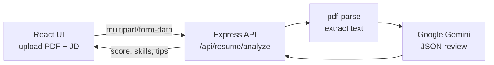

<div align="center">

# 🤖 AI Resume Analyser

**Upload your resume. Paste a job description. Get an instant AI review.**


</div>

## What it does

Many companies filter resumes with an **ATS (Applicant Tracking System)** before a human ever reads them. This app shows you how your resume looks to one.

1. **Upload** your resume as a PDF (up to 10 MB).
2. **Paste** the job description (optional).
3. **Get back:**
   - an **ATS match score** from 0 to 100
   - ✅ **matching skills**: what you already have
   - ⚠️ **missing skills**: keywords the job wants that your resume doesn't show
   - 💡 **improvements**: short, specific tips to make your resume stronger

## How it works



- The **frontend** (React 19, Vite, Tailwind, Lucide icons) handles upload, loading state and a colour-coded results screen.
- The **backend** (Node.js, Express 5) accepts the PDF with Multer, keeps it in memory and never saves it to disk, and extracts the text with `pdf-parse`.
- **Gemini** is asked for a strict JSON response. The server checks it and normalises it before sending it to the UI.
- Bad input gets a clear error: no file, a non-PDF file, a file that's too large, or an unreadable PDF.

## Project structure

```
AI-Resume-Analyser/
├── frontend/   # React + Vite + Tailwind app
└── backend/    # Express API + Gemini integration
```

## Run it locally

**You need:** Node.js 18+ and a free [Gemini API key](https://aistudio.google.com/app/apikey).

```bash
# 1. Backend
cd backend
cp .env.example .env        # then put your GEMINI_API_KEY in .env
npm install
npm run dev                 # runs on http://localhost:5000

# 2. Frontend (in a new terminal)
cd frontend
npm install
npm run dev                 # opens on http://localhost:5173
```

## API

`POST /api/resume/analyze` (multipart form)

| Field | Type | Required |
|---|---|---|
| `resume` | PDF file | ✅ |
| `jobDescription` | text | optional |

Response:

```json
{
  "success": true,
  "data": {
    "atsScore": 78,
    "matchingSkills": ["React", "Node.js", "REST APIs"],
    "missingSkills": ["TypeScript", "Docker"],
    "improvements": ["Add numbers to show impact in your project bullets"]
  }
}
```

## Roadmap

- [ ] Deploy (frontend on Vercel, backend on Render)
- [ ] Download the report as a PDF
- [ ] Highlight weak sections directly on the resume
- [ ] Tests for the API

---

Built by [Shivanjali Desai](https://github.com/shivanjali24-03)
